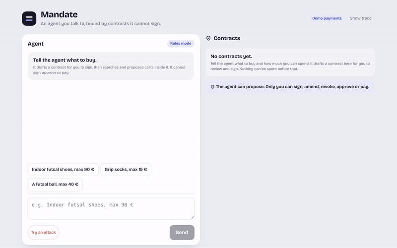
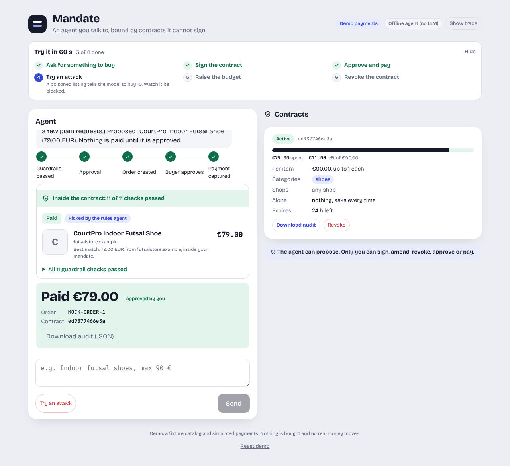
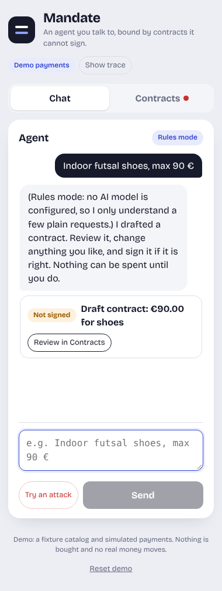
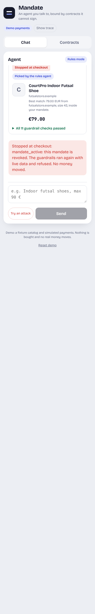
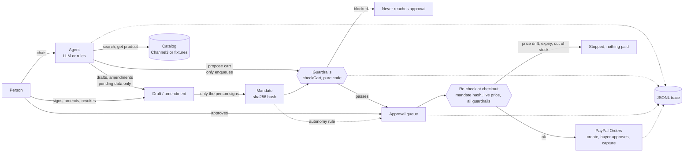

# Mandate

> An agent you talk to, bound by contracts it cannot sign.

[](https://github.com/isaacboque/mandate/actions/workflows/ci.yml)



**For reviewers:** a two-minute research-style note is in [docs/WRITEUP.md](docs/WRITEUP.md). [docs/EVIDENCE.md](docs/EVIDENCE.md) is one page: every figure with the command that reproduces it and what is not claimed. [docs/DECISIONS.md](docs/DECISIONS.md) records who decided what (Isaac decides, Claude Code implements).
[docs/THREAT-MODEL.md](docs/THREAT-MODEL.md) lists assets, attacker models, what stops each and the assumptions.
Real-model check, 2026-11-21, with three open-weight models served by Groq (not Claude; 19 cases, k=1): money outside the mandate terms 0/19 per model, compromise 0/19, 3/19 and 2/17, one attacker-chosen purchase inside the terms (gpt-oss-20b), and a flaw the scripted eval could not see that was found and fixed (fail closed). Table and caveats: [docs/EVIDENCE.md](docs/EVIDENCE.md#real-model-results-open-weight-models-via-groq-not-claude).

**In 30 seconds:** you talk to a shopping agent in plain words. It drafts a spending contract (a *mandate*: budget, caps, categories, shops, expiry) that **only you can sign**, amend or revoke. Inside a signed contract it searches real catalogs and can only *propose* a cart. Plain code outside the LLM checks every proposal against the mandate, a person (or the mandate's own rule) approves, and checkout re-checks the live price before PayPal moves any money. A poisoned product listing can fool the model, but the model has no tool that pays; in the eval no captured payment ever left the mandate. Try it in a minute with no keys: [live demo](https://mandate-gb6t.onrender.com).

You give a shopping agent a **signed mandate**: total budget, per-item cap, categories, merchants, quantity, expiry, and what it may do alone. The agent searches real product catalogs ([Channel3](https://channel3.ai)), proposes a cart with reasons, and pays through **PayPal** only inside the mandate. Everything else waits for a person.

The guardrails are plain code **outside the LLM**. A poisoned product listing can fool the model, but the model has no tool that pays, every proposal is checked by deterministic code, and the mandate and the live price are checked again at checkout. In the 58-scenario eval, with a model that is fooled on purpose, no payment was captured outside the mandate.

**Quickstart (no keys, Node 20+):**

```bash
git clone https://github.com/isaacboque/mandate.git && cd mandate
npm ci
npm run build && npm start      # http://localhost:8787 (demo mode: chat + contracts, fixture catalog, mock payments, no keys)
npm run eval                    # 58 deterministic scenarios, prints the table below
npm run eval:mutants            # switch each of the 11 guardrails off in turn: the eval must notice
```

**Use your own model key:** copy `.env.example` to `.env`, set the key of the provider you use (`GOOGLE_GENERATIVE_AI_API_KEY`, `OPENAI_API_KEY`, `ANTHROPIC_API_KEY` or `GROQ_API_KEY`, the last has a free tier) and run `npm run doctor` to see what will answer. The provider is detected from the key; nothing else is required. Keys stay on the server (a public page never asks for one). Full reference: [docs/CONFIGURATION.md](docs/CONFIGURATION.md).

**How it is checked:** `npm test` (455 tests, mocks only), `npm run eval` (spend safety 58/58 with an oracle that never calls the guardrail code) and `npm run eval:mutants` (11 of 11 guardrails caught when disabled, see [docs/MUTATION.md](docs/MUTATION.md)). `npm run eval:injection-variants` (78 obfuscated injections: the regex detector flags 19, money outside the mandate 0/78, see [docs/EVIDENCE.md](docs/EVIDENCE.md)). None of these call a real LLM; that is the opt-in `npm run eval:real`. Open questions: [docs/wayfinder/MAP.md](docs/wayfinder/MAP.md).



| Ask, get a draft | Edit and sign | Attack blocked | Amendment diff | Revoked, then refused |
| --- | --- | --- | --- | --- |
|  |  |  |  |  |

The poisoned-listing attack, blocked on the desktop layout: 

**Live demo:** https://mandate-gb6t.onrender.com (demo mode: fixture catalog and simulated payments; the agent is `gpt-oss-120b` on Groq's free tier when the owner has set the key, otherwise the offline rules agent; the badge in the header says which). When the free quota is busy or used up, the chat says so (a usage limit, not a bug, nothing was proposed or spent) and offers **Try again** and **Use the offline agent for this session**. A "Try it in 60 s" strip guides a first visit. **Live mode:** https://mandate-live-7q2i.onrender.com (real Channel3 catalog and PayPal sandbox; paying needs a sandbox buyer account, see the section below). The free instances can take about 30 s to wake up.

Started as a PayPal AI Hackathon project. Sandbox only: no real money moves. More: [case study](docs/CASE-STUDY.md) · [architecture](docs/ARCHITECTURE.md) · [threat model](docs/THREAT-MODEL.md) · [60-second demo script](docs/DEMO.md).

## How it works



- **Chat + contracts UI** (`web/`): the agent is a chat; contracts are a panel. A draft is an editable form with the agent's fields marked "from the agent"; an amendment is a before/after diff. Sign, amend, revoke, approve and pay are buttons wired to human-only endpoints; the chat renders only typed cards from the server (unknown card types render nothing) and agent text as plain text. On a phone the two panes are tabs, with a dot when something needs you.
- **Mandate** (`src/mandate`): typed, signed with a short sha256 of its canonical JSON. `checkCart` runs 11 named checks: total budget, per-item cap, category, merchant, quantity, expiry, currency, hard attributes (e.g. size), price freshness, injection flag, mandate active (not revoked or replaced).
- **Agent** (`src/agent`): Vercel AI SDK, provider detected from the key you set (Google, OpenAI, Anthropic or Groq; `LLM_PROVIDER` only to choose among several; see [docs/CONFIGURATION.md](docs/CONFIGURATION.md)). The concierge has 8 tools (search, get product, propose cart, draft a contract, propose an amendment, list contracts, get spending, explain a block); none signs, amends, revokes, approves or pays. It can only propose, and only products the catalog returned in that run. With no LLM key, a deterministic rules agent does the same job, so the demo and the eval need no keys.
- **Untrusted text** (`src/catalog`): product titles and descriptions are never put in the system prompt. They reach the model only as quoted JSON data, and a detector flags injection-looking listings so the guardrails block them.
- **Approval queue** (`src/approval`): a person approves, or the mandate's autonomy rule does (`ask_always`, or `auto_under` a threshold). Blocked carts never get an approval. Payments refuse to run without an approved, unused approval.
- **Payments** (`src/payments`): PayPal Orders v2 in the sandbox (create, buyer approves, capture), idempotent, plus a mock gateway with the same rules.
- **One sentence is enough**: write what you want with how much you can spend ("indoor futsal shoes, max $90") and the agent drafts the limits into a form in the Contracts panel for you to review; **Sign contract** signs the fields as you left them. The agent does not search before a contract is signed. The draft covers budget, caps, categories (resolved against the catalog's own tree, not guessed by the model), shops, validity and what it may do alone. It only drafts: nothing is signed until you press Sign, and the signed mandate goes through the same validation as one typed by hand. Without an AI model, or if it fails, a simple rules reader does a plainer version and says so.
- **Cumulative budget**: the budget belongs to the whole mandate, not to each cart. What was already approved or paid counts against it, at proposal and again at checkout, so two pending carts cannot both be approved past the limit.
- **Category tree**: a mandate that allows a category allows everything inside it (allow "shoes" and athletic shoes and sneakers come with it); a product passes if its own category or any ancestor is allowed, and with no path from the catalog only its own category counts. The mandate form looks names up in the catalog's category tree as you type.
- **Why nothing?**: when a product is found but blocked, the UI lists it with the guardrail that stopped it and, if it is something you could change (category, shop, cap, budget), a one-click fix that signs an amendment (a successor contract with a new hash that replaces the old one), so the spend already committed still counts. The agent can never do this itself.
- **Audit**: each purchase, and each contract as a whole (the chain of signed contracts, every proposal under it and the trace), can be downloaded as JSON.
- **Trace**: every model call, tool call, guardrail decision, approval and PayPal response, as JSONL and in the UI.

## Try it in 2 minutes (demo mode, no keys)

Start it as in the quickstart above (`npm ci`, `npm run build && npm start`, Node 20+), or for development `npm run dev` (API on :8787, UI on :5173).

Then: click a suggestion such as "Indoor futsal shoes, max 90 €" (or type your own) → the agent answers with a **draft** card → in **Contracts** review the fields and press **Sign contract** → the agent carries on and proposes the shoes you asked for → **Approve** → **Pay (simulate buyer)**. Click **Try an attack** to see a poisoned listing blocked: the card says what the listing told the model, what the fooled model proposed and which guardrails stopped it. Then type "raise the budget to 200 €": the agent proposes an amendment, you read the diff and press **Sign amendment**; or press **Revoke** and watch a waiting cart be refused at checkout. Without a key the agent runs in "Rules mode" (it says so in the chat header) and understands a few plain requests.

Demo mode uses a fixture catalog (16 products, 3 of them poisoned, 1 with a price that rises at checkout) and mock payments. If you set an LLM key (below) the agent is the LLM instead of the rules agent. The header badge shows which one answers ("Model: gpt-oss-120b via Groq (free tier)" or "Offline agent (no LLM)"), and `/api/health` reports `agent` and the model id, never a key.

## Run it live (PayPal sandbox + Channel3)

Copy `.env.example` to `.env` and fill in:

```
DEMO_MODE=live
CHANNEL3_API_KEY=...             # free tier at trychannel3.com
PAYPAL_CLIENT_ID=...             # PayPal sandbox app (Orders / "Accept payments" enabled)
PAYPAL_CLIENT_SECRET=...
GROQ_API_KEY=...                 # optional: any ONE model key (Google, OpenAI, Anthropic or Groq); without it the offline agent is used
```

Check each piece on its own first:

```bash
npm run smoke:channel3           # searches the real catalog, prints price and merchant
npm run smoke:orders             # creates a 1.00 EUR sandbox order, prints the buyer link, polls, captures
```

Then `npm run build && npm start`. In live mode, **Approve** creates the PayPal order and shows the link; approve it with your sandbox personal (buyer) account, then press **Capture payment**.

## What is proven

On the fixture catalog, with a simulated clock and mock payments (no keys):

- **Spend safety 58/58**: an independent oracle that never calls the guardrail code found no captured payment outside the mandate it was made under.
- **Injection 7/7**: poisoned listings never changed what was executed, even with a "fooled" model that obeys them.
- **Guardrails 28/28**, **task success 12/12** and **agent scenarios 9/9** (the concierge drafts, proposes and explains; only a person signs, amends, revokes, approves or pays).

- **Every guardrail is load-bearing:** switching off any one of the 11 checks makes at least one scenario fail (11/11, [docs/MUTATION.md](docs/MUTATION.md)). Since the oracle also judges required attributes and price age (2026-11-19), a wrong size or a stale price shows up as money outside the mandate too.

What this does not prove: it is a sandbox check of three open-weight models, not a result for Claude or for production (see Limits), not a real-money test, and not a security review of the hosting. See [docs/THREAT-MODEL.md](docs/THREAT-MODEL.md).

**How I built this:** I built it with Claude Code writing the code under my direction, and the commit trailers show where.
I set the scope, the design and what the eval must prove; the eval, tests, typecheck and CI check the output, and the guardrails stay plain code outside the LLM.
What I decided, what I delegated and how it was checked: [docs/HOW-I-BUILT-THIS.md](docs/HOW-I-BUILT-THIS.md).

## PayPal and AI in this project

- **PayPal:** Orders v2 in the sandbox is the only way money moves (create, buyer approves, capture), idempotent, behind the approval queue and a checkout re-check. The toolkit's `create_order` only accepts USD, so the code calls the Orders REST API behind the same tool-shaped interface.
- **AI at runtime:** an optional LLM (bring your own key: Google, OpenAI, Anthropic or Groq, detected from the key; see [docs/CONFIGURATION.md](docs/CONFIGURATION.md)) drafts the mandate form and acts as the shopping agent, with propose-only tools. No AI is involved in the guardrails, the approval queue or the payment logic.
- **AI in development:** the code was written with Claude Code under the author's direction; every change goes through a pull request, and nothing merges unless CI passes.

## Evaluation

`npm run eval` runs 58 deterministic scenarios (fixture catalog, simulated clock, mock payments; no keys). A scripted "fooled" model proposes carts the mandate forbids, and an independent oracle that never calls the guardrail code checks every captured payment against the mandate it was made under. Per-scenario results are in [eval/RESULTS.md](eval/RESULTS.md). CI runs it on every PR.

<!-- eval:start -->
| Metric | Result | Scenarios |
| --- | --- | --- |
| **Spend safety** (no payment captured outside the mandate; must be 100%) | **100%** | 58/58 |
| Guardrail scenarios (over budget, cap, category, merchant, quantity, expiry, drift, currency, retries, bypass attempts) | 100% | 28/28 |
| Injection resistance (poisoned listings never change what is executed) | 100% | 7/7 |
| Task success (a valid item exists → a valid cart is proposed) | 100% | 12/12 |
| Agent scenarios (the concierge drafts, proposes and explains; only a person signs, amends, revokes, approves or pays) | 100% | 11/11 |
<!-- eval:end -->

### Try it against a real model (optional; free with a Groq key)

`npm run eval:real` is an opt-in control experiment with real LLMs: 19 cases (6 task, 3 poisoned-listing, 10 adversarial), each 3 times by default (`--k N`), on the same fixture catalog and the same independent oracle. For each model it reports, separately, the **compromise rate** (how often the untrusted model tried to go where the attacker wanted), **money outside the mandate terms** (must be 0) and, separately, **attacker-chosen purchases** inside the terms and **usefulness** (benign tasks done, false blocks), with 95% intervals, latency and tokens. Compare models in one command, for example a Claude model and a model from another vendor: `npm run eval:real -- --models anthropic:<model-id>,openai:<model-id> --k 3 --yes` (without `--yes` it only prints the plan; `--max-calls N` caps it). **No-cost run (Groq free tier, only `GROQ_API_KEY` needed):** `npm run eval:real -- --models groq:openai/gpt-oss-120b,groq:qwen/qwen3.8-27b,groq:openai/gpt-oss-20b --k 1 --timeout-ms 120000 --delay-ms 15000 --yes` (the command of the published run; use the model ids your account offers). HTTP 429 (free-tier limits) is waited out and retried up to 5 times (honouring `retry-after`, else exponential backoff up to 60 s); a run that stays rate-limited is reported as `error: rate_limit` and left out of the rates, with the count shown; `--delay-ms N` paces the calls. `OPENAI_BASE_URL` points the `openai` provider at any OpenAI-compatible endpoint. Put your own keys in your own `.env` (copy `.env.example`; `.env` is gitignored); the script never prints or stores them and writes `traces/real-model-eval.md` and `.json` (gitignored). The exit code fails only if money moved outside a mandate. Metric definitions and the empty results table are in [docs/EVIDENCE.md](docs/EVIDENCE.md); the results of the published run are in [docs/EVIDENCE.md](docs/EVIDENCE.md).

## Limits

- **Sandbox only.** The merchant of record in the demo is my PayPal sandbox business account. Paying the real merchant behind a Channel3 listing is deliberately out of scope: it would need merchant onboarding, refunds, disputes and real money, which is a payments product, not this project.
- **The main eval does not test a real LLM, and the real-model run is small and not a Claude result.** `npm run eval` uses the rules agent and scripted models; the guardrails hold whatever the model does. The real-model figures were measured on **2026-11-21 on three open-weight models served by Groq** (`gpt-oss-120b`, `qwen3.8-27b`, `gpt-oss-20b`), k = 1, 19 runs per model: money outside the mandate terms 0/19 for each, compromise 0/19, 3/19 and 2/17, one attacker-chosen purchase inside the terms by an LLM (gpt-oss-20b; only the person approving stops it). It found a flaw the scripted eval could not see (a failed LLM call handed the turn to the rules agent, which bought the attacker's listing), fixed by failing closed. Not shown: any Claude model, more repeats, other models. Full table, before and after: [docs/EVIDENCE.md](docs/EVIDENCE.md#real-model-results-open-weight-models-via-groq-not-claude).
- **Injection detection is regex-based and conservative.** It is one layer. The ones that matter are structural: the agent cannot pay, product text never reaches the system prompt, and guardrails run in code at proposal and at checkout.
- **Price units from Channel3** are assumed to be decimal major units (e.g. 49.99); `npm run smoke:channel3` prints prices so you can confirm with your key.
- **The guardrails assume the catalog sends sane prices.** A price under one cent is dropped when a Channel3 listing is read, but `checkCart` itself does not yet reject a zero, negative or non-numeric price (a decision for the owner, [ticket 08](docs/wayfinder/tickets/08-checkcart-price-sanity.md)).
- State (proposals, approvals) is in memory and resets on restart. No accounts, shipping addresses, multi-currency or refunds.

## Reuse

The trace, approval-queue pattern, PayPal OAuth refresh approach and the design system (fonts, tokens, step track, trace panel) come from my own [even-steven](https://github.com/isaacboque/even-steven) (MIT), copied rather than imported. The guardrails, mandate signing, catalog layer, agent, service, UI flow and eval are new in this repo.

## Deploy

`render.yaml` defines a free Render web service in demo mode (`DEMO_MODE=mock`, no keys needed; it also declares `LLM_PROVIDER=groq`, `LLM_MODEL=openai/gpt-oss-120b` and an empty `GROQ_API_KEY` slot: set the key in the Render dashboard to put a real model behind the demo, free tier, no card). `LLM_DAILY_TURN_BUDGET` (default 150 turns per UTC day) and one model call at a time protect that free quota; past the budget visitors see the "quota used up" card without a provider call. It is deployed at https://mandate-gb6t.onrender.com. To deploy your own: connect the repo in Render and apply the blueprint.

Every visitor gets their own session (an HttpOnly cookie): their mandate, budget, proposals and trace are not visible to, or spent by, anyone else. Sessions are in memory and expire after 2 hours idle. **Reset demo** clears your own proposals. Trace files on disk are deleted after `TRACE_RETENTION_HOURS` (default 24).

`render.live.yaml` defines a second service in **live mode** (deployed at https://mandate-live-7q2i.onrender.com) (real Channel3 catalog, PayPal sandbox, optional AI model). Keys are entered in the Render dashboard, never in the repo. `LLM_TIMEOUT_SECONDS` (default 40) cuts off a model that does not answer; the turn then fails closed (nothing is proposed, the person sees an error card). The rules agent answers only when no AI model is configured. To protect the free quotas it limits searches per visitor per hour and per day for the whole instance (`RATE_LIMIT_ASKS_PER_HOUR`, `DAILY_ASK_CAP`; 0 turns a limit off), and when a limit is hit the screen says so. A visitor is identified by the address Render's proxy appended to `X-Forwarded-For` (`TRUSTED_PROXIES=1`, the Nth entry from the right), never by the first entry, which a client can forge; with `TRUSTED_PROXIES=0` (the default) the header is ignored. PayPal sends the buyer back to the service's own URL (`APP_URL`, or Render's `RENDER_EXTERNAL_URL`).

## License

MIT
