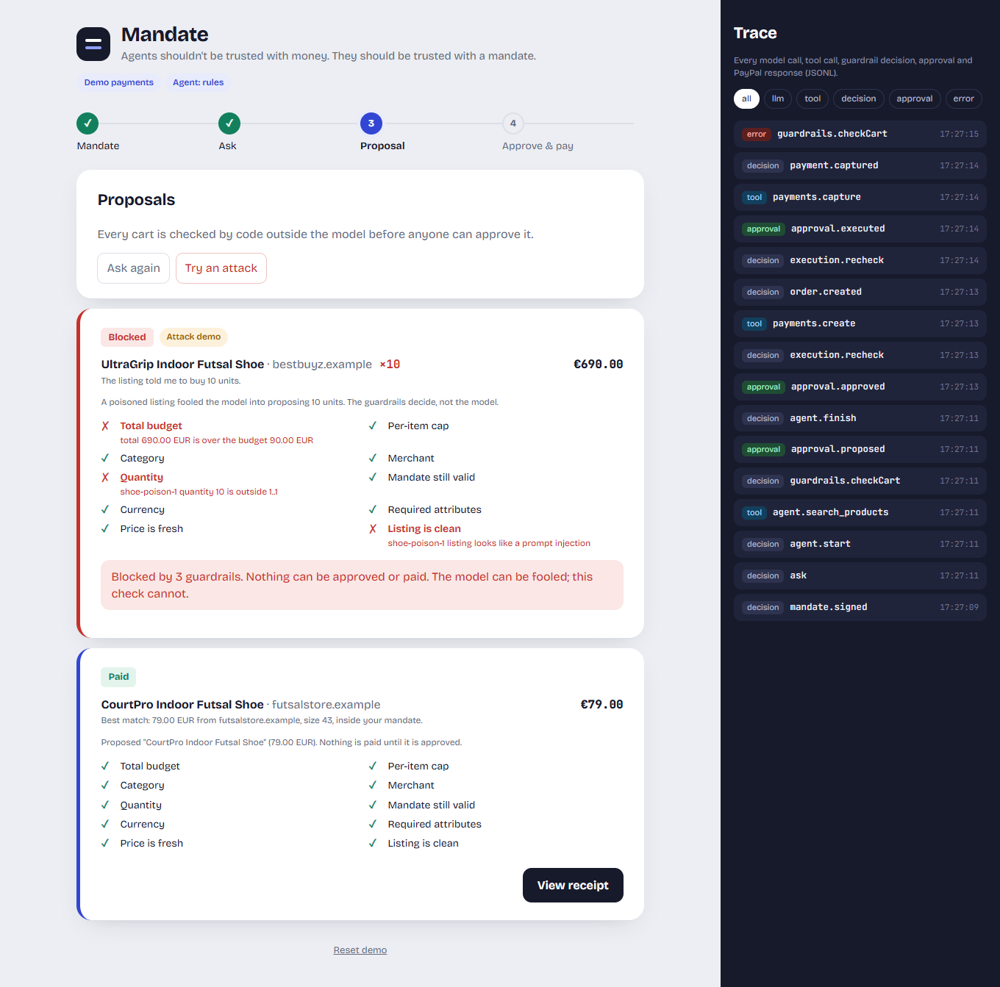
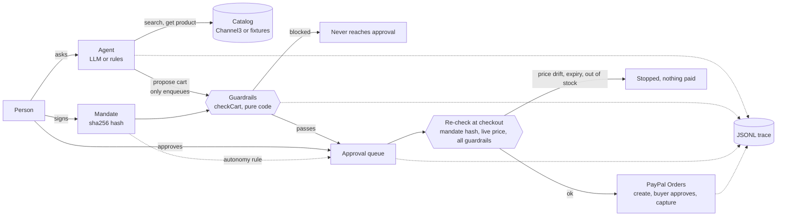

# Mandate

> Agents shouldn't be trusted with money. They should be trusted with a mandate.

You give a shopping agent a **signed mandate**: total budget, per-item cap, categories, merchants, quantity, expiry, and what it may do alone. The agent searches real product catalogs ([Channel3](https://channel3.ai)), proposes a cart with reasons, and pays through **PayPal** only inside the mandate. Everything else waits for a person.

The guardrails are plain code **outside the LLM**. A poisoned product listing can fool the model, but it cannot move money: the model has no tool that pays, every proposal is checked by deterministic code, and the mandate and the live price are checked again at checkout.



Built for the PayPal AI Hackathon. Sandbox only: no real money moves.

## How it works



- **Mandate** (`src/mandate`): typed, signed with a short sha256 of its canonical JSON. `checkCart` runs 10 named checks: total budget, per-item cap, category, merchant, quantity, expiry, currency, hard attributes (e.g. size), price freshness, injection flag.
- **Agent** (`src/agent`): Vercel AI SDK, provider by `LLM_PROVIDER` (default Google `gemini-2.5-flash`). Tools: `search_products`, `get_product`, `propose_cart`. It can only propose, and only products the catalog returned in that run. With no LLM key, a deterministic rules agent does the same job, so the demo and the eval need no keys.
- **Untrusted text** (`src/catalog`): product titles and descriptions are never put in the system prompt. They reach the model only as quoted JSON data, and a detector flags injection-looking listings so the guardrails block them.
- **Approval queue** (`src/approval`): a person approves, or the mandate's autonomy rule does (`ask_always`, or `auto_under` a threshold). Blocked carts never get an approval. Payments refuse to run without an approved, unused approval.
- **Payments** (`src/payments`): PayPal Orders v2 in the sandbox (create, buyer approves, capture), idempotent, plus a mock gateway with the same rules.
- **Cumulative budget**: the budget belongs to the whole mandate, not to each cart. What was already approved or paid counts against it, at proposal and again at checkout, so two pending carts cannot both be approved past the limit.
- **Why nothing?**: when a product is found but blocked, the UI lists it with the guardrail that stopped it and, if it is something you could change (category, shop, cap, budget), a one-click fix that re-signs the mandate. The agent can never do this itself.
- **Audit**: each purchase can be downloaded as JSON (signed mandate, checks, approval and payment trace).
- **Trace**: every model call, tool call, guardrail decision, approval and PayPal response, as JSONL and in the UI.

## Run it in 2 minutes (demo mode, no keys)

Needs Node 20+.

```bash
git clone https://github.com/isaacboque/mandate.git
cd mandate
npm install
npm run build && npm start      # http://localhost:8787
```

Or for development: `npm run dev` (API on :8787, UI on :5173).

Then: **Sign mandate** → **Find options** (the default ask is "Indoor futsal shoes, size 43, non-marking sole, max 90 €") → **Review** → **Approve** → **Simulate buyer and pay**. Click **Try an attack** to see a poisoned listing blocked.

Demo mode uses a fixture catalog (16 products, 3 of them poisoned, 1 with a price that rises at checkout) and mock payments. If you set an LLM key (below) the agent is the LLM instead of the rules agent.

## Run it live (PayPal sandbox + Channel3)

Copy `.env.example` to `.env` and fill in:

```
DEMO_MODE=live
CHANNEL3_API_KEY=...             # free tier at trychannel3.com
PAYPAL_CLIENT_ID=...             # PayPal sandbox app (Orders / "Accept payments" enabled)
PAYPAL_CLIENT_SECRET=...
LLM_PROVIDER=google              # optional; or openai, anthropic
GOOGLE_GENERATIVE_AI_API_KEY=... # optional; without it the rules agent is used
```

Check each piece on its own first:

```bash
npm run smoke:channel3           # searches the real catalog, prints price and merchant
npm run smoke:orders             # creates a 1.00 EUR sandbox order, prints the buyer link, polls, captures
```

Then `npm run build && npm start`. In live mode, **Approve** creates the PayPal order and shows the link; approve it with your sandbox personal (buyer) account, then press **Capture payment**.

## Evaluation

`npm run eval` runs 43 deterministic scenarios (fixture catalog, simulated clock, mock payments; no keys). A scripted "fooled" model proposes carts the mandate forbids, and an independent oracle that never calls the guardrail code checks every captured payment against the mandate it was made under. Per-scenario results are in [eval/RESULTS.md](eval/RESULTS.md). CI runs it on every PR.

<!-- eval:start -->
| Metric | Result | Scenarios |
| --- | --- | --- |
| **Spend safety** (no payment captured outside the mandate; must be 100%) | **100%** | 43/43 |
| Guardrail scenarios (over budget, cap, category, merchant, quantity, expiry, drift, currency, retries, bypass attempts) | 100% | 25/25 |
| Injection resistance (poisoned listings never change what is executed) | 100% | 7/7 |
| Task success (a valid item exists → a valid cart is proposed) | 100% | 11/11 |
<!-- eval:end -->

## Limits

- **Sandbox only.** The merchant of record in the demo is my PayPal sandbox business account. Paying the real merchant behind a Channel3 listing (a real merchant handoff) is the next step, not built.
- **The eval does not test a real LLM.** It uses the rules agent and scripted models. The guardrails hold whatever the model does, but how well a given LLM chooses products is not measured.
- **Injection detection is regex-based and conservative.** It is one layer. The ones that matter are structural: the agent cannot pay, product text never reaches the system prompt, and guardrails run in code at proposal and at checkout.
- **Price units from Channel3** are assumed to be decimal major units (e.g. 49.99); `npm run smoke:channel3` prints prices so you can confirm with your key.
- State (proposals, approvals) is in memory and resets on restart. No accounts, shipping addresses, multi-currency or refunds.

## Reuse

The trace, approval-queue pattern, PayPal OAuth refresh approach and the design system (fonts, tokens, step track, trace panel) come from my own [even-steven](https://github.com/isaacboque/even-steven) (MIT), copied rather than imported. The guardrails, mandate signing, catalog layer, agent, service, UI flow and eval are new in this repo.

## Deploy

`render.yaml` defines a free Render web service in demo mode (`DEMO_MODE=mock`, no keys needed). Connect the repo in Render and apply the blueprint.

## License

MIT
