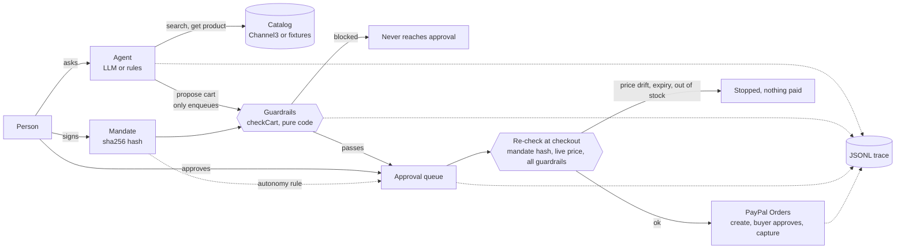

# Architecture

The idea in one line: **the model can propose, never pay.** Spending authority lives in a signed mandate that plain code enforces, at proposal time and again at checkout.

## The pieces

| Part | Where | Role |
| --- | --- | --- |
| Mandate | `src/mandate` | Typed spending limits, signed with a short sha256 of the canonical JSON. `checkCart` runs 10 named checks: total budget, per-item cap, category, merchant, quantity, expiry, currency, hard attributes, price freshness, injection flag. |
| Agent | `src/agent` | Vercel AI SDK, provider chosen by `LLM_PROVIDER`. Three tools: `search_products`, `get_product`, `propose_cart`. None can pay; `propose_cart` only enqueues and only accepts products the catalog returned in that run. Without an LLM key a deterministic rules agent does the same job. |
| Catalog | `src/catalog` | Channel3 (live) or a fixture catalog (demo and eval). Product text is untrusted: it reaches the model only as quoted JSON, and a detector flags injection-looking listings. |
| Approval queue | `src/approval` | A person approves, or the mandate's autonomy rule does (`ask_always` or `auto_under` a threshold). Blocked carts never get an approval. Payments refuse to run without an approved, unused approval. |
| Payments | `src/payments` | PayPal Orders v2 in the sandbox (create, buyer approves, capture), idempotent, plus a mock gateway with the same rules. |
| Service | `src/service` | Glue: proposals, cumulative budget, execution-time re-check, audit export. |
| Trace | `src/trace` | Every model call, tool call, guardrail decision, approval and PayPal response, as JSONL and in the UI. |

## A purchase, step by step

1. The person writes a request ("indoor futsal shoes, max $90"). An assistant drafts the limits into a form; nothing is signed yet.
2. The person reviews and signs. Only now does the agent search.
3. The agent calls the catalog and proposes a cart with a reason per line.
4. `checkCart` runs outside the model. A blocked cart stops here and the UI says which guardrail stopped it.
5. A passing cart waits for approval (a person, or the autonomy rule).
6. At checkout the service re-reads the live price and re-runs the mandate hash and every guardrail, including the budget already approved or paid. Price drift, expiry or a stock-out stops the payment.
7. PayPal creates the order, the buyer approves, the capture happens. The purchase can be downloaded as a JSON audit.

## Design rules

- Money is integer cents.
- The budget belongs to the mandate, not to a cart: approved and paid amounts count against it.
- The guardrails fail closed when data is missing.
- Tests and the eval use mocks only; no keys, no network.
